# Guía visual: migración de EGS con cPanel


## Tu guía de migración

**EGS Comercializadora · Administración + WordPress**

Pasos para preparar, restaurar y poner en funcionamiento la copia en el nuevo hosting.

**1 · Preparar**Panel, dominios, bases y archivos**2 · Ensayar**Restauración privada y comprobaciones**3 · Cambiar**Copia final, DNS y tareas automáticas

**Referencia visual: cPanel.** El panel del nuevo proveedor aún no está confirmado. Las capturas se tomaron de la demostración pública de cPanel Jupiter 138; **no son de tu nueva cuenta**. Verás `example` y `example.com`: sustitúyelos por los datos de EGS.

Los comandos corresponden al asistente ya preparado. La guía no contiene contraseñas, llaves ni autorizaciones reales.

**Copia disponible:** preliminar del 16 de octubre de 2026. Primero se ensaya; para el cambio definitivo se necesita una copia final.


## 00 · Antes de empezar

Guarda estos datos del **nuevo proveedor**. Usa su enlace de acceso, porque el dominio público todavía apunta al servidor actual.

| Dato | Anótalo aquí |
| --- | --- |
| URL segura del panel | ________________________________ |
| Usuario y carpeta Home | ________________________________ |
| IP nueva / servidor SSH / puerto | ________________________________ |
| PHP web + ruta PHP CLI compatibles | ________________________________ |
| Servidor de bases y puerto | ________________________________ |
| SMTP, puerto y cifrado | ________________________________ |

- Confirma SSH o Terminal, `exec`/`proc_open`, PDO MySQL y SQLite, curl, gd, mbstring, openssl, xml/dom, zip, fileinfo y zlib.
- Confirma GNU tar, gzip, GnuPG, mysql/mariadb, mysqldump/mariadb-dump, flock y logrotate.
- El origen usa PHP 7.1 y plugins antiguos. La versión del destino necesita pruebas; no se certificó todo el sistema en PHP 8.
- Ambos sitios deben poder acceder al mismo directorio privado de Drive.

Si no aparecen Terminal/SSH, SQLite o la posibilidad de separar los directorios públicos, pide al proveedor resolverlo antes de restaurar. El asistente no instala paquetes del sistema.


**Resultado esperado:** Tienes los datos nuevos y el proveedor confirmó compatibilidad.


## 01 · Entra al panel correcto

1. Abre el enlace HTTPS que te entregó el nuevo proveedor. cPanel suele usar el puerto `2083`.
2. Inicia sesión con las credenciales de esa cuenta.
3. Localiza **Current User**, **Home Directory** y la IP nueva en la información general.
4. Usa el buscador superior para encontrar las herramientas citadas en los siguientes pasos.

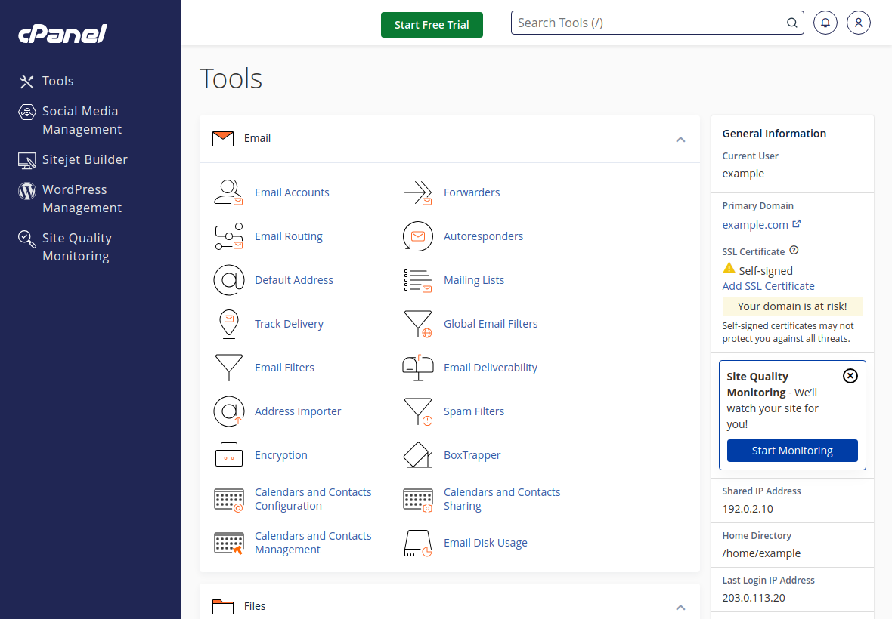
Captura real de la demo pública: inicio de cPanel y datos generales.

No uses `comercializadoraegs.com/cpanel` como única referencia antes del corte: podría abrir el panel del hosting anterior.


**Resultado esperado:** El usuario y la IP corresponden al nuevo hosting.


## 02 · Da de alta los dos sitios

Abre **Domains → Create A New Domain**. Si el dominio principal ya aparece en la lista, conserva esa entrada.

| Dominio | Raíz esperada — ejemplo |
| --- | --- |
| comercializadoraegs.com | /home/USUARIO/public_html |
| backend.comercializadoraegs.com | /home/USUARIO/backend.comercializadoraegs.com |

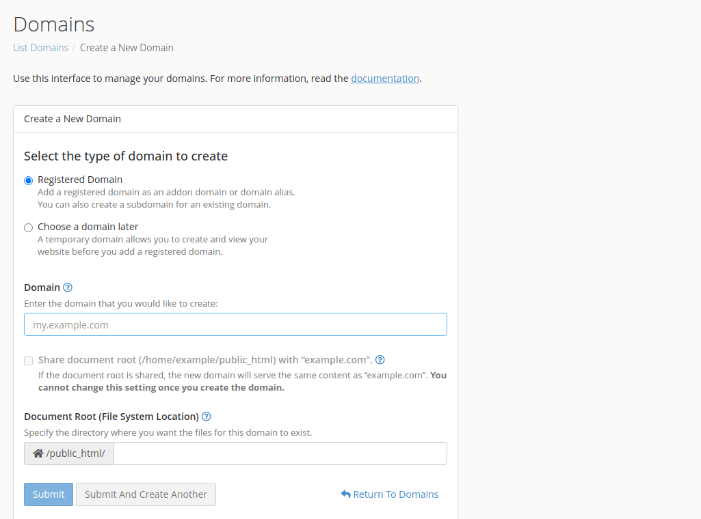
Formulario real de creación de dominio. El prefijo public_html mostrado es una restricción de esta demo.

Para el backend, desmarca la opción de compartir la raíz. Los dos directorios deben quedar separados.

**Si el campo te obliga a crear el backend dentro de `public_html`, detente y pide al proveedor una raíz fuera de esa carpeta.** Nuestro kit no admite que un sitio esté contenido dentro del otro. No instales otro WordPress desde el panel.


**Resultado esperado:** Los dominios existen con raíces separadas. Aún no cambiaste DNS.


## 03 · Crea cuatro bases vacías

Busca **Manage My Databases**. En versiones anteriores puede llamarse **MySQL Databases**.

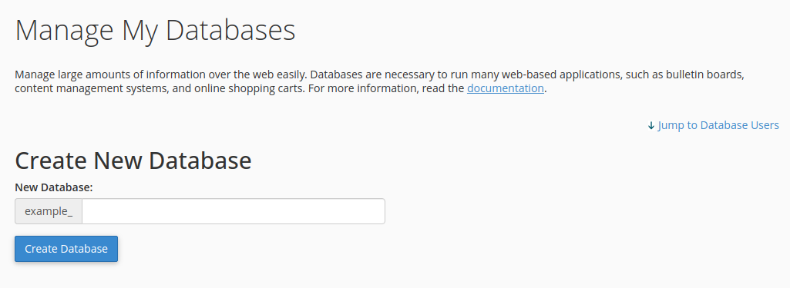
Captura real: campo para crear una base; el prefijo lo añade cPanel.

| Sufijo sugerido | Contenido que recibirá |
| --- | --- |
| ecommerce | Productos / e-commerce · 36 tablas en la copia preliminar |
| ordenes | WordPress + órdenes · una base compartida, 146 tablas |
| wordpress_anterior | Base adicional anterior · 3 tablas |
| sisanweb | Base conservada sin tablas |

Crea una por una y anota sus nombres **completos**, incluido el prefijo que muestre el panel. Los conteos definitivos los indica el manifiesto del paquete final.

Se crean cuatro bases físicas. Las conexiones lógicas `wordpress` y `site` deben apuntar ambas a `USUARIO_ordenes`. No crees una quinta base para separarlas.


**Resultado esperado:** Hay cuatro bases nuevas y vacías, creadas desde cPanel.


## 04 · Crea usuarios y concede acceso

En la misma pantalla, crea dos usuarios sugeridos: `app` y `wp`. Usa contraseñas nuevas y guárdalas de forma privada.

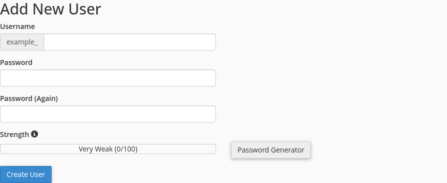
Captura real: alta de usuario. Las contraseñas se dejan vacías en la guía.

Después, en **Add User To Database**, agrega cada relación y concede **ALL PRIVILEGES** sobre esa base nueva.

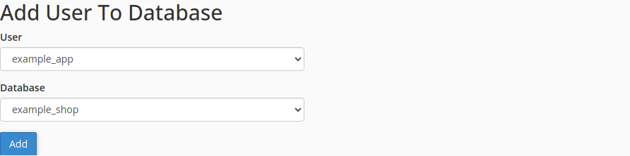
Captura real: selector para relacionar usuario y base.

| Usuario sugerido | Bases a las que debe acceder |
| --- | --- |
| USUARIO_app | ecommerce, ordenes y sisanweb |
| USUARIO_wp | ordenes y wordpress_anterior |

Copia los nombres reales del panel. Su prefijo puede diferir del usuario de acceso. Las contraseñas se escribirán en el JSON privado, no en capturas ni en Git.


**Resultado esperado:** Ambos usuarios tienen acceso a sus bases, incluida la base compartida.


## 05 · Prepara la carpeta privada

Abre **File Manager**. Ve a **Home**, no a `public_html`. En **Settings** activa **Show Hidden Files** y guarda el ajuste.

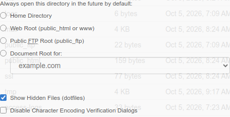
Captura real: preferencias del administrador y opción para mostrar archivos ocultos.

Crea únicamente `.egs-migration` dentro de tu Home. La estructura esperada es:

Referencia · carpetas

```text
/home/USUARIO/
  .egs-migration/   ← herramientas, paquete y configuración privada
  public_html/     ← raíz pública de WordPress
  backend.comercializadoraegs.com/  ← raíz pública del sistema
```

Todavía no crees `.egs-drive` ni `.egs-backup`: las creará el restaurador. Ningún paquete, llave o configuración privada debe quedar dentro de los dos sitios públicos.


**Resultado esperado:** Existe /home/TU_USUARIO/.egs-migration fuera de los sitios.


## 06 · Sube el kit y la copia cifrada

Dentro de `.egs-migration`, usa **Upload**. Comprueba la carpeta de destino antes de seleccionar archivos.

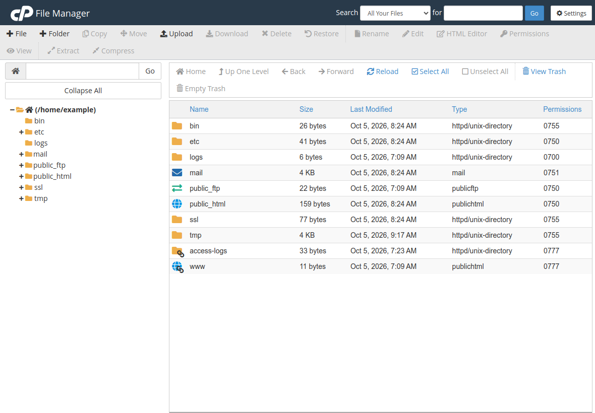
Captura real: File Manager y botón Upload. La pantalla de transferencia no está incluida en la demo.

| Archivo que debes subir | Para qué sirve |
| --- | --- |
| kit-migracion-egs.tar.gz | Asistente y adaptaciones |
| egs-preliminar-20261016.tar.gz.gpg | Copia cifrada · aproximadamente 601 MB |
| egs-preliminar-20261016.tar.gz.gpg.json | Tamaño, SHA-256 y manifiesto |

Transfiere por separado `llave-migracion-20261016.key` a la misma carpeta privada del servidor. Es la llave para descifrar el respaldo; **no es una llave SSH**.

Si el panel rechaza el archivo grande, usa SFTP/SCP o pide al proveedor la transferencia privada. No lo descomprimas en tu PC para subir carpetas sueltas. El comando del paso 9 descifra el paquete en el servidor.


**Resultado esperado:** Los tres archivos y la llave están en la carpeta privada, no en la web.


## 07 · Abre Terminal y extrae el kit

En cPanel busca **Terminal**; si no aparece, conecta por SSH con el acceso del proveedor. Los siguientes bloques se ejecutan en el **Linux del nuevo hosting**.

Linux · Terminal

```text
id -un
printf "%s\n" "$HOME"
php -v
command -v php
```

Compara usuario, Home y PHP con los datos del paso 0. Prepara el asistente:

Linux · Terminal

```text
cd "$HOME/.egs-migration"
umask 077
mkdir -p kit
tar -xzf kit-migracion-egs.tar.gz -C kit
chmod 700 "$HOME/.egs-migration"
chmod 600 llave-migracion-20261016.key
php kit/ops/migration/migrate.php help
```

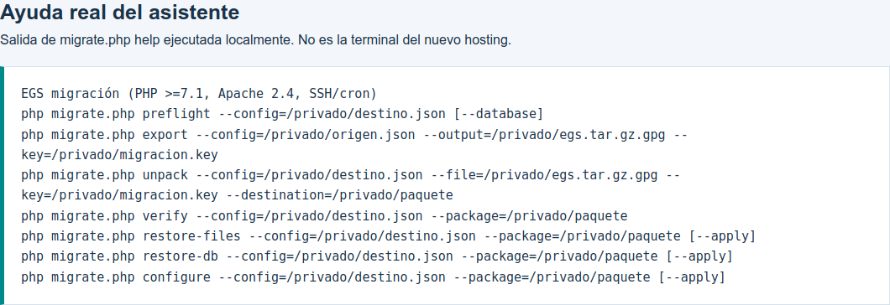
Vista de la ayuda real del asistente ejecutada localmente; no es una sesión de tu nuevo hosting.

Si `php` no corresponde al PHP acordado, pide su ruta real y úsala en `EGS_PHP` en el siguiente paso. Mantén la sesión abierta mientras termina cada operación.


**Resultado esperado:** Aparecen los comandos preflight, unpack, verify, restore-files, restore-db y configure.


## 08 · Completa destino.json

Copia la plantilla y edítala desde File Manager → Edit. Mantén `mode` en `staging`.

Linux · Terminal

```text
cd "$HOME/.egs-migration"
cp kit/ops/migration/hosting.example.json destino.json
chmod 600 destino.json
```

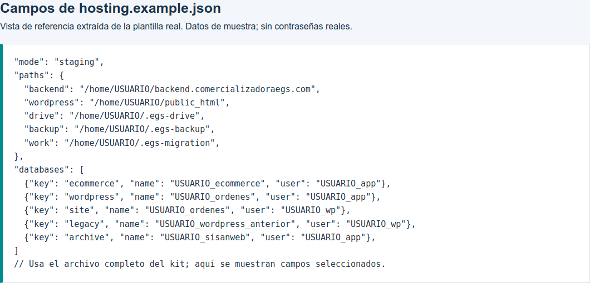
Vista de la plantilla real del kit, con campos de muestra y base compartida.

| Campo | Qué escribir |
| --- | --- |
| paths | Rutas absolutas del nuevo Home; work = .egs-migration |
| databases | Host, puerto, nombre completo, usuario y contraseña nuevos |
| wordpress + site | Mismo host, puerto y nombre de base; pueden usar usuarios distintos |
| binaries.php | Ruta real del PHP CLI confirmado con el proveedor |
| environment / MAIL_* | SMTP para órdenes; validar también el plugin SMTP de WordPress |

No modifiques las claves `ecommerce`, `wordpress`, `site`, `legacy` y `archive`. Conserva los dominios EGS. Sustituye todos los valores USUARIO y CAMBIAR y evita errores de comas/comillas.


**Resultado esperado:** El JSON contiene datos del destino, sigue en staging y está fuera de la web.


## 09 · Aparta las carpetas iniciales

El panel puede haber creado `public_html` y la carpeta del backend. **El restaurador necesita que esas rutas no existan**, aunque estén vacías.


Captura de referencia: seleccionar carpeta y localizar Rename en la barra.

1. Confirma que estás en el hosting nuevo y que las carpetas sólo tienen la bienvenida del proveedor.
2. En File Manager → Home, selecciona `public_html` y usa **Rename**: por ejemplo, `public_html.inicial-egs`.
3. Aparta del mismo modo la carpeta inicial del backend si ya existe. Conserva esos originales.
4. Comprueba que las rutas exactas de `paths.wordpress`, `paths.backend`, `paths.drive` y `paths.backup` aún no existen.

No renombres carpetas del servidor antiguo ni una instalación que ya tenga datos reales. Si no sabes qué contienen o el panel no permite el cambio, pide al proveedor preparar los destinos. No uses borrados recursivos para forzar la restauración.


**Resultado esperado:** Las cuatro rutas de restauración están disponibles como directorios nuevos.


## 10 · Descifra y verifica la copia

Define estas variables en Terminal. Se usan en los siguientes bloques; si abres otra sesión, vuelve a definirlas.

Linux · Terminal

```text
EGS_PHP="$(command -v php)"
EGS_TOOL="$HOME/.egs-migration/kit/ops/migration/migrate.php"
EGS_CONFIG="$HOME/.egs-migration/destino.json"
EGS_ARCHIVE="$HOME/.egs-migration/egs-preliminar-20261016.tar.gz.gpg"
EGS_KEY="$HOME/.egs-migration/llave-migracion-20261016.key"
EGS_PACKAGE="$HOME/.egs-migration/paquete"
```

Si el proveedor indicó otro PHP CLI, reemplaza `EGS_PHP` por esa ruta. Ejecuta un bloque y espera a que termine:

Linux · Terminal

```text
"$EGS_PHP" "$EGS_TOOL" unpack \
  --config="$EGS_CONFIG" --file="$EGS_ARCHIVE" \
  --key="$EGS_KEY" --destination="$EGS_PACKAGE"
```

Linux · Terminal

```text
"$EGS_PHP" "$EGS_TOOL" verify \
  --config="$EGS_CONFIG" --package="$EGS_PACKAGE"
```

Revisa el manifiesto: la copia de ensayo indica `kind: preliminary`. El verificador coteja las huellas, compresión y rutas de los archivos.

Si falla el descifrado o un checksum, no sigas. Comprueba que la llave y el paquete correspondan. El destino de `unpack` también debe ser nuevo.


**Resultado esperado:** Ambos comandos terminan sin ERROR y devuelven el manifiesto.


## 11 · Restaura los archivos de los sitios

Primero muestra la propuesta. Este comando aún no restaura archivos:

Linux · Terminal

```text
"$EGS_PHP" "$EGS_TOOL" restore-files \
  --config="$EGS_CONFIG" --package="$EGS_PACKAGE"
```

Comprueba las cuatro rutas. Deben corresponder al Home nuevo y a las raíces del paso 2. Después aplica la restauración:

Linux · Terminal

```text
"$EGS_PHP" "$EGS_TOOL" restore-files \
  --config="$EGS_CONFIG" --package="$EGS_PACKAGE" --apply
```

| Se restaura | Ubicación definida por |
| --- | --- |
| Administración | paths.backend |
| WordPress completo | paths.wordpress |
| Índices y OAuth de Drive | paths.drive |
| Configuración y llave de respaldos previos | paths.backup |

El correo queda dentro del paquete privado para importarlo con el proveedor. Este paso no lo instala automáticamente. Si aparece “el directorio destino debe ser nuevo”, revisa el paso 9; no vuelvas a ejecutar sobre carpetas restauradas.


**Resultado esperado:** La salida indica applied: true y se crearon los cuatro directorios.


## 12 · Importa las cuatro bases

Previsualiza la relación de bases de origen y destino:

Linux · Terminal

```text
"$EGS_PHP" "$EGS_TOOL" restore-db \
  --config="$EGS_CONFIG" --package="$EGS_PACKAGE"
```

Si los destinos son correctos y están vacíos, importa:

Linux · Terminal

```text
"$EGS_PHP" "$EGS_TOOL" restore-db \
  --config="$EGS_CONFIG" --package="$EGS_PACKAGE" --apply
```

| Clave principal | Claves que comparten base | Tablas de esta copia |
| --- | --- | --- |
| ecommerce | ecommerce | 36 |
| wordpress | wordpress y site | 146 |
| legacy | legacy | 3 |
| archive | archive | 0 |
| Total | 4 bases físicas | 185 |

Puedes revisar las tablas en phpMyAdmin. Los nombres y el conteo de una copia final podrían cambiar; manda su manifiesto.

Una base con tablas se rechaza para evitar sobrescrituras. Si una importación queda a medias, crea nuevos esquemas vacíos y actualiza el JSON con ayuda del proveedor. No ignores errores SQL ni reintentes sobre una base parcialmente importada.


**Resultado esperado:** applied: true; coinciden los conteos y la base compartida.


## 13 · Aplica la configuración de ensayo

Con `mode: staging`, revisa y aplica los cambios:

Linux · Terminal

```text
"$EGS_PHP" "$EGS_TOOL" configure \
  --config="$EGS_CONFIG" --package="$EGS_PACKAGE"
```

Linux · Terminal

```text
"$EGS_PHP" "$EGS_TOOL" configure \
  --config="$EGS_CONFIG" --package="$EGS_PACKAGE" --apply
```

Después ejecuta la revisión:

Linux · Terminal

```text
"$EGS_PHP" "$EGS_TOOL" preflight \
  --config="$EGS_CONFIG" --database
```

- Configura las rutas privadas, conexiones, lector de Drive y puentes de WordPress.
- Genera el entorno privado y los archivos `crontab.pending` y `logrotate.conf` en `paths.work`.
- Guarda los archivos modificados antes de configurarlos en `before-configure-*`.
- No instala las tareas del destino.

**Un POST que devuelve 503 en staging es esperado.** El modo de ensayo limita escrituras externas, correos de órdenes y WP-Cron. No actives production para probar cargas contra la biblioteca real mientras el origen siga aceptando operaciones.


**Resultado esperado:** La configuración se aplicó y preflight muestra ok: true en el destino.


## 14 · Confirma PHP después de configurar

Regresa a **MultiPHP Manager**. Selecciona ambos dominios y aplica la versión que el proveedor haya validado con la aplicación.

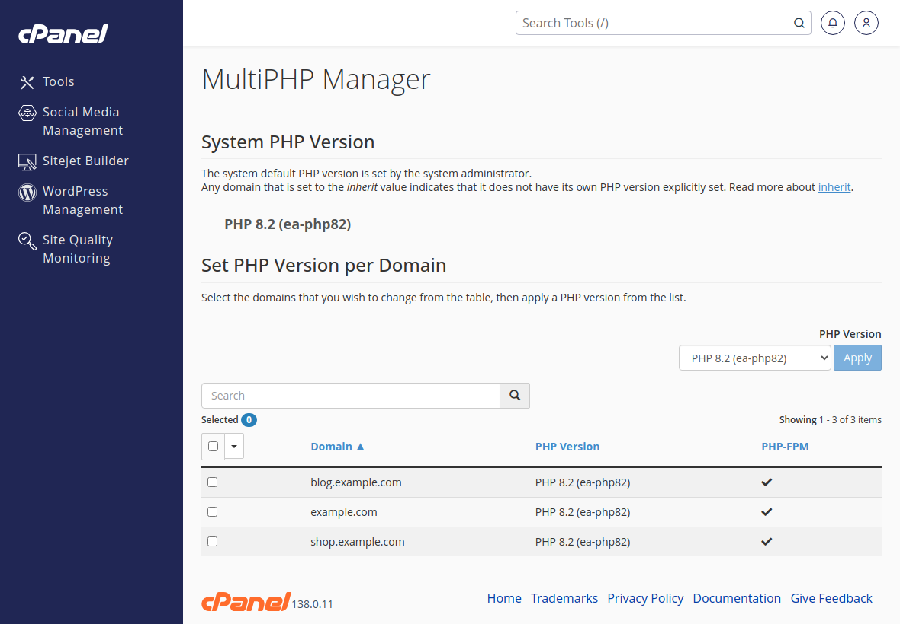
Captura real: selección de dominios y versión PHP; las versiones de la demo son sólo referencia.

Revisa también **MultiPHP INI Editor** para cada sitio: memoria, ejecución, tamaño de subida y sesiones. El configurador elimina handlers y rutas de sesiones del hosting anterior; **vuelve a aplicar los ajustes del panel después de cada configure --apply**, también durante el corte.

- La versión del comando `"$EGS_PHP" -v` y la versión web deben ser compatibles. Si tienen rutas distintas, corrige `binaries.php` y `EGS_PHP`.
- No copies la ruta antigua `/var/cpanel/php/sessions/...`. El proveedor debe dar una ubicación válida.
- Los límites del origen son referencia, no capacidad mínima ni garantía de compatibilidad.

PHP 7.1 está fuera de soporte. Si el destino sólo tiene PHP moderno, valida WordPress, plugins y sistema antes del corte; la prueba del lector de Drive no certifica todos esos módulos.


**Resultado esperado:** Ambos sitios ejecutan el PHP acordado y usan sesiones válidas del destino.


## 15 · Obtén HTTPS para ambos dominios

Abre **SSL/TLS Status** o **SSL/TLS Certificates**, según la versión del panel. Comprueba que el certificado cubra el dominio público y el backend.

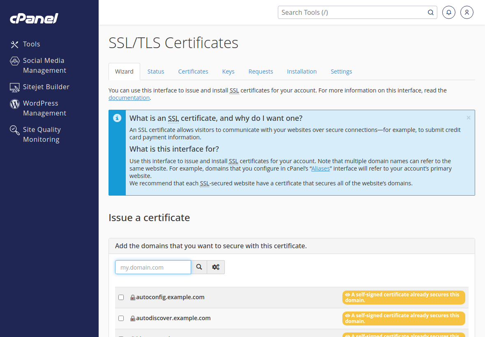
Captura real: interfaz SSL/TLS de la demo. Sus dominios y estados no son los de EGS.

Como los registros públicos todavía apuntan al origen, AutoSSL puede no validar por HTTP en el nuevo servidor. Pide al proveedor un certificado público válido mediante validación DNS o la instalación de uno vigente, sin adelantar el cambio de A/AAAA.

Para probar directamente con hosts o curl, el certificado debe ser confiable para el navegador. Un certificado Cloudflare Origin CA por sí solo no es confiable en una conexión directa normal. No ocultes errores SSL para dar la prueba por buena.


**Resultado esperado:** HTTPS del nuevo servidor es válido para los dos dominios.


## 16 · Apunta sólo tu PC al destino

Haz esta prueba en **Windows**. Conserva una copia de tu archivo hosts y abre Bloc de notas como administrador.

1. Abre `C:\Windows\System32\drivers\etc\hosts`. En el diálogo usa “Todos los archivos”.
2. Añade al final las dos líneas siguientes usando la IP real nueva.
3. Guarda el archivo sin extensión .txt. Quita entradas duplicadas de esos dominios si ya existían, conservando su respaldo.

Windows · ejemplo de archivo hosts

```text
203.0.113.50 comercializadoraegs.com
203.0.113.50 backend.comercializadoraegs.com
```

`203.0.113.50` es una IP de documentación: **debes cambiarla por la del proveedor**. Si vas a usar www, agrega también ese nombre.

Windows · PowerShell o CMD

```text
ipconfig /flushdns
```

Abre una ventana privada del navegador y revisa HTTPS en ambos sitios. Si el navegador, una VPN o DNS seguro evita la resolución local, usa la prueba explícita del siguiente paso.

Este cambio afecta sólo tu PC. No modifica Cloudflare ni el tráfico de los demás usuarios. Retira estas líneas cuando termine la migración.


**Resultado esperado:** Tu PC alcanza el servidor nuevo con los mismos dominios y HTTPS válido.


## 17 · Comprueba páginas e imagen de una orden

Desde **PowerShell de Windows**, puedes comprobar el origen nuevo sin cambiar DNS. Sustituye la IP de ejemplo:

Windows · PowerShell

```text
curl.exe --resolve "backend.comercializadoraegs.com:443:203.0.113.50" -I "https://backend.comercializadoraegs.com/"
```

- Abren la tienda, el backend y las páginas públicas de privacidad y condiciones.
- Los datos existentes corresponden a la copia y el lector sirve imágenes desde Drive.
- El acceso por navegador a `/.env` y a `/config/Database.php` queda denegado: 403 o 404, sin mostrar contenido privado.
- Las peticiones POST siguen bloqueadas durante el ensayo. Login y creación de órdenes necesitan la prueba controlada del corte o servicios aislados de prueba.

Para comprobar la imagen histórica de la orden **12323**, usa la URL y el bloque Windows incluido en `COMANDOS.md`. Su MD5 esperado es:

Referencia · imagen histórica

```text
5feb2838718142ec846247d70740fb97
```

En la copia ya validada se restauraron 185 tablas y esa imagen se leyó desde Drive, usando las rutas nuevas y sin archivo local. Esa evidencia corresponde al ensayo realizado aquí, no a tu futuro servidor.

No inicialices otra biblioteca Drive ni vuelvas a subir toda la multimedia. Mantén los índices, el cliente OAuth, tokens y la biblioteca existentes.


**Resultado esperado:** Las lecturas funcionan en el nuevo origen y las restricciones del ensayo siguen activas.


## 18 · Prepara las cinco cuentas de correo

Abre **Email Accounts**. Decide con el proveedor si moverá correo ahora o si se conservará temporalmente en el servidor anterior.

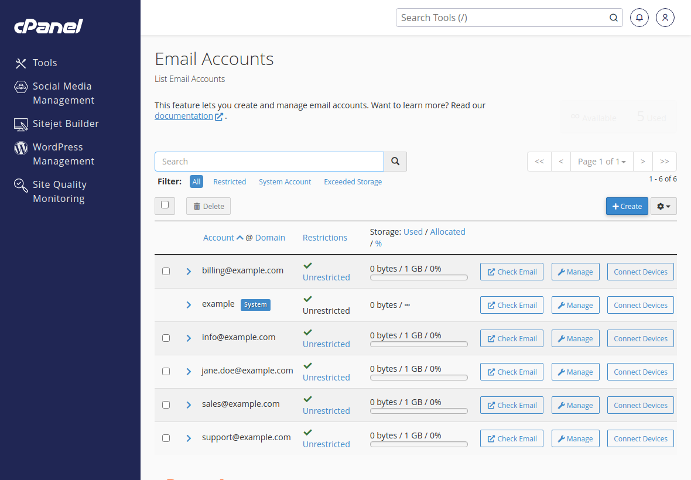
Captura real de cuentas de correo de la demo; los buzones mostrados son de ejemplo.

| Cuenta EGS | Observación |
| --- | --- |
| egs.compras@comercializadoraegs.com | Punto entre egs y compras |
| egs_compras@comercializadoraegs.com | Guion bajo: es otro buzón |
| contacto@comercializadoraegs.com | Conservar historial y acceso |
| facturacion@comercializadoraegs.com | Conservar historial y acceso |
| desarrolloweb@comercializadoraegs.com | Conservar historial y acceso |

Entrega al proveedor `mail.tar.gz` y `mail_config.tar.gz` desde el paquete privado para importar Maildir, cuentas, alias y configuración. Revisa filtros, redirecciones y cuotas.

No extraigas mail_config en /etc del sistema. Si el correo permanece en el origen, conserva mail/MX apuntando allí; no conviertas mail en alias del dominio web que vas a mover. Actualiza SMTP de órdenes y el plugin SMTP de WordPress cuando cambien credenciales.


**Resultado esperado:** Está acordada la importación o continuidad del correo y sus registros.


## 19 · Pausa antes del cambio definitivo

Hasta aquí preparaste y probaste una copia. **No uses la copia preliminar como respaldo final de corte.**

1. Acuerda una ventana con el responsable del servidor actual y del nuevo hosting.
2. El responsable del origen suspende escrituras, APIs, WP-Cron, pagos/webhooks y tareas; espera que terminen procesos activos.
3. Coordina pausa o sincronización delta del correo.
4. Conserva DNS y crontab anteriores para reversión.
5. Pide una exportación final nueva, generada con las escrituras suspendidas mediante `export --final --quiesced`.

`--quiesced` declara que el operador ya congeló los productores de datos. El asistente no congela automáticamente WordPress, pagos, correo ni el servidor actual.

El paquete final debe tener su propio recibo de verificación. El manifiesto indica `final_operator_confirmed_quiesced`. Nunca cambies ese texto a mano para convertir una copia preliminar en final.

Mantén el origen sin escrituras hasta que el destino quede aprobado. Esto evita dos bases activas y dos índices Drive que se separen.


**Resultado esperado:** Tienes una copia final real y el origen permanece congelado.


## 20 · Restaura la copia final sin pisar el ensayo

En el servidor nuevo, aparta las carpetas públicas del ensayo como hiciste en el paso 9. Conserva esas copias fuera de los directorios públicos.

1. Crea cuatro bases nuevas con otro sufijo, por ejemplo `_final`, y concede sus permisos.
2. Copia tu JSON a `destino-final.json`, mantén staging y cambia los nombres de bases. Conserva el alias wordpress/site.
3. Usa directorios privados nuevos para Drive, respaldos y trabajo.
4. Sube el paquete final y su recibo por transferencia privada. Si cambió la llave, usa su llave correspondiente.

| Campo del JSON final | Ejemplo de destino nuevo |
| --- | --- |
| paths.drive | /home/USUARIO/.egs-drive-final |
| paths.backup | /home/USUARIO/.egs-backup-final |
| paths.work | /home/USUARIO/.egs-migration-final |
| Raíces públicas | Las mismas del dominio; deben estar libres para restaurar |

Actualiza las variables de Terminal y repite los pasos **10 → 15** con la copia final:

Linux · Terminal

```text
EGS_CONFIG="$HOME/.egs-migration/destino-final.json"
EGS_ARCHIVE="$HOME/.egs-migration/egs-final.tar.gz.gpg"
EGS_PACKAGE="$HOME/.egs-migration-final/paquete"
```

Los nombres de arriba son ejemplos: deben coincidir con los archivos recibidos y las rutas reales. No sobrescribas tablas del ensayo para “actualizarlas”. Los directorios de restauración y de unpack deben ser nuevos.


**Resultado esperado:** La copia final está restaurada y verificada con datos del corte.


## 21 · Activa producción y valida antes de DNS

1. Confirma que el origen continúa sin escrituras y que las variables apuntan al JSON y paquete finales.
2. Edita `destino-final.json`: cambia sólo `mode` de staging a production.
3. Revisa la propuesta y aplica la configuración con los comandos siguientes.
4. Vuelve al paso 14: reaplica PHP/INI del panel y comprueba HTTPS.
5. Haz una prueba controlada de login, orden, comentario, imagen, PDF, tienda y correo. Usa pagos en sandbox o el procedimiento acordado para pruebas reales.

Linux · Terminal

```text
"$EGS_PHP" "$EGS_TOOL" configure \
  --config="$EGS_CONFIG" --package="$EGS_PACKAGE"
```

Linux · Terminal

```text
"$EGS_PHP" "$EGS_TOOL" configure \
  --config="$EGS_CONFIG" --package="$EGS_PACKAGE" --apply
```

Comprueba que una foto nueva se guarda en Drive y que su URL anterior sigue funcionando. Verifica ambas aplicaciones y los permisos del directorio compartido.

Si la prueba genera órdenes, pagos o archivos reales, ya existe información nueva en el destino. Desde ese momento una reversión necesita reconciliar esos datos; no regreses simplemente a una base antigua.


**Resultado esperado:** El destino funciona en producción bajo la ventana de corte acordada.


## 22 · Cambia DNS en Cloudflare

Entra a la cuenta que administra `comercializadoraegs.com` y abre **DNS → Records**. Guarda los valores anteriores.

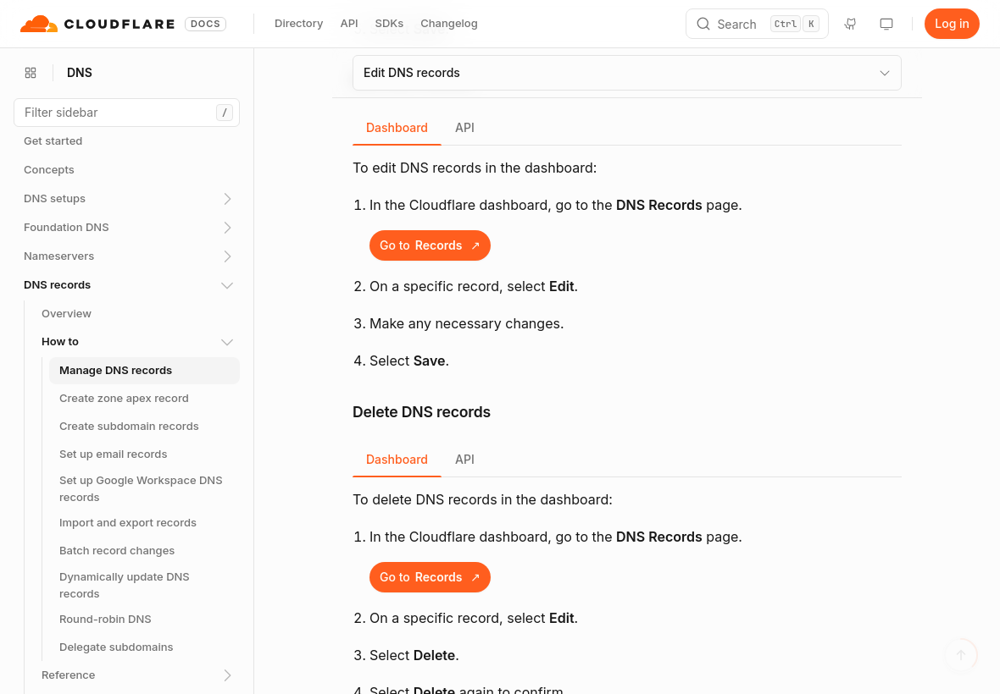
Captura de la documentación oficial de Cloudflare sobre edición de registros; no es tu cuenta.

1. Edita el registro que dirige el dominio raíz al origen nuevo, según lo indicado por el proveedor.
2. Revisa el registro de backend y cualquier www usado. Si ya son alias, comprueba su destino antes de agregar duplicados.
3. Revisa AAAA: no deben seguir enviando usuarios a un IPv6 del hosting anterior.
4. Conserva la configuración de proxy que corresponda y un certificado válido; no cambies a Flexible para esconder un fallo SSL.
5. Cambia mail/MX, DKIM, SPF y DMARC sólo si también se mueve correo, con los valores confirmados por el proveedor.

Los DNS auditados están en Cloudflare. Editar sólo Zone Editor del nuevo cPanel no sustituye ese cambio. No necesitas transferir el registro del dominio ni cambiar nameservers para mover únicamente el origen web.


**Resultado esperado:** Los registros de web apuntan al destino y el correo sigue la ruta prevista.


## 23 · Activa únicamente las tareas nuevas

Antes de añadirlas, confirma que las tareas equivalentes del origen estén detenidas. Abre el archivo `crontab.pending` del **paths.work final**.

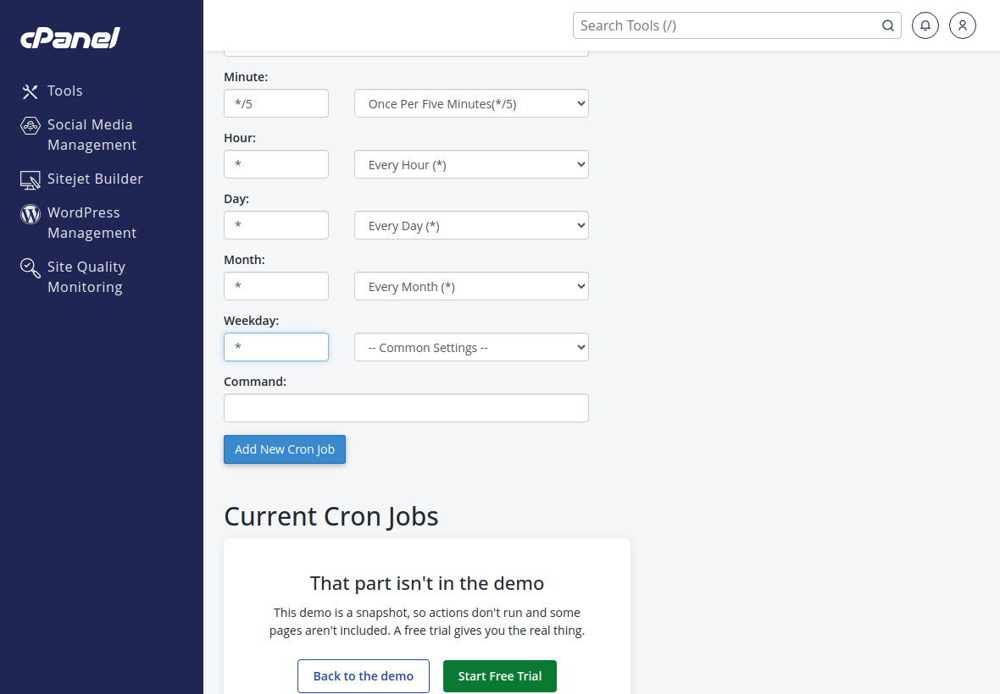
Captura real del formulario cron; sólo se llenaron campos de ejemplo y no se guardó una tarea.

| Tarea | Minuto | Hora / día / mes / semana |
| --- | --- | --- |
| Organizar imágenes | */5 | * / * / * / * |
| Revisar respaldo diario/semanal | */15 | * / * / * / * |
| Mantenimiento de logs | */15 | * / * / * / * |

En cPanel → **Cron Jobs**, añade una fila por tarea. Copia en **Command** la parte de cada línea que viene *después* de los cinco campos de horario. Conserva rutas, comillas y redirecciones.

No reemplaces todo el crontab ni pegues el horario dentro de Command. No copies los antiguos workers de migración ni el borrado anual de multimedia. El respaldo se comprueba cada 15 minutos y se programa a las 03:00 de CDMX; conserva 7 diarios y 4 semanales.


**Resultado esperado:** Hay una sola instalación activa de las tres tareas, en el destino.


## 24 · Cierra la migración y conserva reversión

- Retira de tu PC las líneas de hosts agregadas en el paso 16 y limpia la caché DNS local.
- Comprueba desde otra conexión que se está viendo el origen nuevo. Puedes usar un archivo de validación temporal, sin secretos, con contenido único en el nuevo backend y retirarlo tras comprobarlo.
- Verifica órdenes, comentarios, fotos, reportes, tienda, callbacks y correos según el plan de pruebas.
- Revisa el próximo respaldo completo y su recuperación. Si ya existía una copia del día, el programa puede reutilizarla: no tomes una ejecución sin errores como prueba de una copia nueva.
- Confirma que los respaldos siguen privados y que sus llaves están guardadas por separado.
- Mantén el origen congelado durante el periodo acordado; no canceles el hosting anterior antes de completar también el correo.

**Si hay que volver atrás**

| Situación | Cómo actuar |
| --- | --- |
| Aún no hay operaciones nuevas | Restaurar DNS del origen, sus tareas y acceso, siguiendo el plan acordado. |
| Ya hay órdenes, pagos o imágenes nuevas | Pausar operaciones y reconciliar bases, correo e índice Drive antes de revertir. |

Al terminar, retira del servidor los paquetes y SQL temporales que ya no necesites, conservando copias cifradas y llaves seguras. No borres los directorios privados activos de Drive ni de los respaldos.


**Resultado esperado:** Usuarios, correo, imágenes y respaldos funcionan; existe una reversión controlada.


## Soluciones rápidas

| Lo que aparece | Qué revisar |
| --- | --- |
| El directorio destino debe ser nuevo | Apartar sólo las carpetas iniciales/ensayo del nuevo hosting; comprobar JSON. |
| La base destino debe estar vacía | Usar un esquema nuevo con permisos. No forzar importación sobre tablas existentes. |
| POST o login devuelve 503 en ensayo | Es la restricción staging. Hacer pruebas de escritura durante el corte controlado o con servicios aislados. |
| Falta herramienta / extensión PHP | Pedir al proveedor el módulo o binario y confirmar la ruta del PHP CLI. |
| No conecta a MySQL/MariaDB | Host, puerto, usuario, prefijo, contraseña y permisos; validar compatibilidad del cliente PHP con autenticación del servidor. |
| Imágenes Drive devuelven 503 | Revisar índice, tokens, permisos compartidos y HTTPS saliente; no crear una biblioteca nueva. |
| Error de certificado | Comprobar nombres, vigencia, cadena de confianza e IP de prueba; coordinar validación DNS. |
| configure cambia la versión/ajustes PHP | Reaplicar MultiPHP Manager e INI en el destino y comprobar versión web/CLI. |
| Correo no sale tras el traslado | Revisar SMTP del JSON y plugin de WordPress, credenciales, DNS de mail y autorización de pruebas. |

Los errores deben resolverse antes de abrir el destino al público. El kit no actualiza automáticamente WordPress, sus plugins o todos los módulos del sistema.


## Fuentes y archivos de apoyo

Capturas realizadas el 16 de octubre de 2026. Las pantallas de cPanel proceden de la demo pública; sus ejemplos no acreditan la configuración de ninguna cuenta EGS.

- [cPanel: demostración pública](https://trycpanel.net/)
- [cPanel: dominios y raíces](https://docs.cpanel.net/cpanel/domains/domains/create-a-new-domain/)
- [cPanel: bases y usuarios](https://docs.cpanel.net/cpanel/databases/manage-my-databases/)
- [cPanel: administrador de archivos](https://docs.cpanel.net/cpanel/files/file-manager/)
- [cPanel: Terminal](https://docs.cpanel.net/cpanel/advanced/terminal-in-cpanel/)
- [cPanel: MultiPHP Manager](https://docs.cpanel.net/cpanel/software/multiphp-manager-for-cpanel/)
- [cPanel: SSL/TLS](https://docs.cpanel.net/cpanel/security/ssl-tls-status/)
- [cPanel: tareas cron](https://docs.cpanel.net/cpanel/advanced/cron-jobs/)
- [Cloudflare: editar registros DNS](https://developers.cloudflare.com/dns/manage-dns-records/how-to/create-dns-records/)
- [Microsoft: edición de hosts con permisos de administrador](https://learn.microsoft.com/en-us/troubleshoot/windows-server/networking/cannot-modify-hosts-lmhosts-files)
- [PHP: versiones fuera de soporte](https://www.php.net/eol.php)

**Dentro de la entrega:** PDF para imprimir; HTML con índice, casillas y botones para copiar; COMANDOS.md con bloques separados; destino.ejemplo.json sin credenciales reales.

La guía técnica original está en `docs/MIGRACION_HOSTING.md`. El paquete preliminar y su llave están en las ubicaciones privadas indicadas en el índice de entrega anterior.

Las capturas de la ayuda y de la plantilla muestran archivos reales del kit en un visor local. No son pantallas de cPanel ni resultados de ejecución en el nuevo hosting. cPanel es una marca de WebPros.
